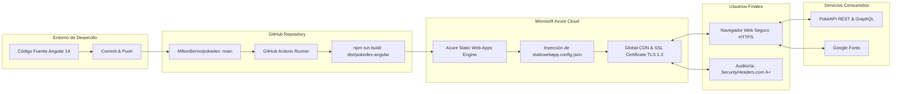

# 🚀 Manual de Despliegue y Aseguramiento en la Nube — PokeDex Angular

[](https://azure.microsoft.com/)
[](https://github.com/features/actions)
[](https://securityheaders.com/)
[](https://www.ssllabs.com/)
[](https://stackedit.io/)

---

## 📑 Resumen Ejecutivo y Ficha Técnica

El presente documento detalla la metodología técnica para compilar, publicar y blindar la aplicación **Pokédex** en la nube pública de **Microsoft Azure**, utilizando el servicio especializado **Azure Static Web Apps** e integración continua con **GitHub Actions**, cumpliendo estrictamente con los lineamientos de ciberseguridad exigidos por **Pueblo Paleta Inc.** para obtener una calificación **A+** en **SecurityHeaders.com**.

| Parámetro | Especificación |
| :--- | :--- |
| **Cliente / Empresa** | Pueblo Paleta Inc. |
| **Proyecto** | Pokédex Web Application (Generaciones I, II y III) |
| **Autor / Desarrollador** | Milton Berrío |
| **Repositorio GitHub** | [https://github.com/MiltonBerrio/pokedex](https://github.com/MiltonBerrio/pokedex) |
| **URL Pública en Producción** | **[https://gentle-pebble-03dd9761e.4.azurestaticapps.net](https://gentle-pebble-03dd9761e.4.azurestaticapps.net)** |
| **Servicio de Nube** | **Azure Static Web Apps (Free Tier)** |
| **Pipeline de Automatización** | GitHub Actions Workflow (`.github/workflows/azure-static-web-apps-*.yml`) |
| **Meta de Seguridad** | **Calificación A+ (100% de puntos en seguridad y encabezados)** |

---

## 🏛️ 1. Arquitectura del Despliegue en la Nube

La solución implementa una arquitectura moderna de distribución de aplicaciones web estáticas basadas en **Jamstack / SPA (Single Page Application)**, respaldada por la red global de entrega de contenidos (CDN) y la infraestructura de borde (Edge) de Microsoft:



### Componentes de la Arquitectura:
1. **GitHub Repository**: Alberga el control de versiones en `https://github.com/MiltonBerrio/pokedex`.
2. **GitHub Actions**: Orquesta el pipeline automatizado de integración y entrega continua (CI/CD).
3. **Azure Static Web Apps**: Servicio en la nube optimizado para hospedar aplicaciones Angular en la capa gratuita (`Free Tier`), proporcionando aprovisionamiento de certificados SSL automáticos, CDN global y soporte para encabezados HTTP personalizados.
4. **PokéAPI**: Servicio RESTful y GraphQL externo que provee la información, estadísticas y recursos multimedia de los Pokémon.

---

## ⚙️ 2. Prerrequisitos del Sistema

Antes de iniciar el procedimiento de publicación, asegúrese de contar con:

* **Node.js**: Versión LTS (recomendado v16.x o v18.x).
* **NPM**: Gestor de paquetes de Node (v8.x o superior).
* **Angular CLI**: Instalado globalmente o ejecutable mediante `npx` (`@angular/cli@14`).
* **Git**: Instalado y configurado en el sistema operativo local.
* **Repositorio Remoto en GitHub**: Repositorio público o privado denominado `pokedex` bajo la cuenta `MiltonBerrio`.
* **Cuenta Activa de Microsoft Azure**: Cuenta de Azure for Students creada y validada previamente (consulte el [README.md](README.md) para el tutorial de creación).

---

## 🛠️ 3. Preparación y Optimización del Proyecto Angular

Para garantizar que el despliegue funcione sin enlaces caídos, errores de rutas internas (404) ni bloqueos de seguridad, se realizaron las siguientes configuraciones clave en el proyecto:

### 3.1. Corrección de la Ruta de Imágenes en Producción (`environment.prod.ts`)
En implementaciones previas para GitHub Pages, las rutas de las imágenes incluían el subdirectorio del repositorio (`/pokedex-angular/assets/images`). Al desplegar en la raíz de un dominio o subdominio en Azure, dicha ruta debe apuntar a la raíz del sitio web.

En el archivo `src/environments/environment.prod.ts`:
```typescript
export const environment = {
  production: true,
  pokeApi: 'https://pokeapi.co/api/v2',
  pokeApiGraphQL: 'https://beta.pokeapi.co/graphql/v1beta',
  homeAngular: 'https://angular.io/',
  homePokeApi: 'https://pokeapi.co/',
  keilerLinkedin: 'https://www.linkedin.com/in/keilermora/',
  pokedexGithub: 'https://github.com/keilermora/pokedex-angular',
  imagesPath: '/assets/images', // Ruta absoluta correcta para Azure
  language: 'en',
  languageId: 9,
};
```

---

### 3.2. Configuración de Reglas y Encabezados de Seguridad (`staticwebapp.config.json`)
Azure Static Web Apps utiliza el archivo `staticwebapp.config.json` para gestionar el comportamiento del servidor web en el borde (Edge). Este archivo resuelve dos necesidades críticas:
1. **Fallback de navegación SPA**: Redirige todas las solicitudes de páginas (ej. `/pokemon/1` o `/about`) a `index.html` para que el enrutador de Angular gestione la vista sin arrojar un error HTTP 404 del servidor.
2. **Encabezados HTTP de Seguridad Globales**: Aplica las políticas necesarias para obtener una calificación **A+** en **SecurityHeaders.com**.

El archivo `staticwebapp.config.json` se encuentra ubicado en la raíz del proyecto y en `src/`:

```json
{
  "$schema": "https://json.schemastore.org/staticwebapp.config.json",
  "navigationFallback": {
    "rewrite": "/index.html",
    "exclude": ["/assets/*", "/*.{png,jpg,jpeg,gif,svg,ico,css,js}"]
  },
  "globalHeaders": {
    "Strict-Transport-Security": "max-age=31536000; includeSubDomains; preload",
    "Content-Security-Policy": "default-src 'self'; script-src 'self'; style-src 'self' 'unsafe-inline' https://fonts.googleapis.com; font-src 'self' https://fonts.gstatic.com; img-src 'self' data: https:; connect-src 'self' https://pokeapi.co https://beta.pokeapi.co; frame-ancestors 'none'; object-src 'none'; base-uri 'self';",
    "X-Frame-Options": "DENY",
    "X-Content-Type-Options": "nosniff",
    "Referrer-Policy": "strict-origin-when-cross-origin",
    "Permissions-Policy": "accelerometer=(), camera=(), geolocation=(), gyroscope=(), magnetometer=(), microphone=(), payment=(), usb=()"
  },
  "mimeTypes": {
    ".json": "text/json"
  }
}
```

---

### 3.3. Inclusión del Archivo de Configuración en `angular.json`
Para asegurar que `staticwebapp.config.json` sea empaquetado en la carpeta de distribución final (`dist/pokedex-angular`), se registró en la propiedad `assets` de `angular.json`:

```json
"assets": [
  "src/favicon.ico",
  "src/og-image.jpg",
  "src/assets",
  "src/404.html",
  "src/staticwebapp.config.json"
]
```

---

### 3.4. Prueba de Compilación Local
Abra una terminal en la raíz del proyecto y ejecute la compilación para validar que el bundle se genere sin errores:

```bash
npm run build
```

*Verifique que se cree el directorio `dist/pokedex-angular` y que contenga tanto los archivos `.js` y `.css` como `index.html` y `staticwebapp.config.json`.*

---

## 🌐 4. Tutorial Paso a Paso: Publicación en Azure Static Web Apps

El siguiente procedimiento explica cómo vincular el repositorio de GitHub con **Microsoft Azure** para lograr un despliegue 100% automatizado.

---

### Paso 4.1: Acceso al Portal de Azure y Creación del Recurso
1. Inicie sesión en el portal de Azure: **[https://portal.azure.com/](https://portal.azure.com/)**.
2. En la barra de búsqueda superior, escriba **"Static Web Apps"** (o *Aplicaciones web estáticas*) y seleccione dicho servicio.
3. Haga clic en el botón **"+ Crear"** (Create).

---

### Paso 4.2: Configuración Básica del Recurso
En la pestaña **Aspectos básicos** (Basics), configure los siguientes campos:

| Campo | Valor Recomendado | Descripción |
| :--- | :--- | :--- |
| **Suscripción** | `Azure for Students` | Suscripción académica activa |
| **Grupo de recursos** | `rg-pokedex-production` | Grupo de recursos creado para el proyecto |
| **Nombre** | `swa-pokedex` | Nombre único para identificar el recurso |
| **Tipo de plan** | `Gratis: para aplicaciones para aficionados o personales` | Sin costo financiero (Free Tier) |
| **Región de Azure Functions y almacenamiento provisional** | `East US 2` | Región con baja latencia |

---

### Paso 4.3: Conexión con el Repositorio de GitHub
En la misma pantalla, configure la sección **Detalles de implementación**:

1. **Origen de la implementación**: Seleccione **"GitHub"**.
2. Haga clic en el botón **"Iniciar sesión con GitHub"** y autorice a Microsoft Azure para acceder a su cuenta.
3. Una vez autenticado, complete los desplegables:
   - **Organización**: `MiltonBerrio` (su usuario de GitHub).
   - **Repositorio**: `pokedex`.
   - **Rama**: `main`.

---

### Paso 4.4: Parámetros de Compilación (Build Details)
Configure los parámetros de compilación específicos para el framework **Angular**:

* **Ajustes preestablecidos de compilación (Build Presets)**: Seleccione **`Angular`**.
* **Ubicación de la aplicación (App location)**: `/`
* **Ubicación de la API (Api location)**: *(Dejar en blanco / vacío)*
* **Ubicación de los artefactos (Output location / App artifact location)**: `dist/pokedex-angular`

> ⚠️ **Importante**: La ubicación de salida debe coincidir exactamente con `dist/pokedex-angular`, tal como está definido en `angular.json`.

---

### Paso 4.5: Revisión y Creación
1. Haga clic en **"Revisar y crear"** en la parte inferior.
2. Tras la validación de sintaxis, haga clic en **"Crear"**.
3. Azure iniciará el aprovisionamiento del recurso. En unos segundos aparecerá el mensaje: *"Se completó la implementación"*.
4. Haga clic en **"Ir al recurso"**.

---

### Paso 4.6: Inspección del Pipeline Automático en GitHub Actions
Al crear la aplicación web estática, Azure realiza automáticamente dos acciones en su repositorio de GitHub:
1. Añade un secreto en el repositorio llamado `AZURE_STATIC_WEB_APPS_API_TOKEN_<ID>`.
2. Realiza un commit en la rama `main` creando el archivo de flujo de trabajo `.github/workflows/azure-static-web-apps-<nombre>.yml`.

Contenido del pipeline generado por Azure:
```yaml
name: Azure Static Web Apps CI/CD

on:
  push:
    branches:
      - main
  pull_request:
    types: [opened, synchronize, reopened, closed]
    branches:
      - main

jobs:
  build_and_deploy_job:
    if: github.event_name == 'push' || (github.event_name == 'pull_request' && github.event.action != 'closed')
    runs-on: ubuntu-latest
    name: Build and Deploy Job
    steps:
      - uses: actions/checkout@v3
        with:
          submodules: true

      - name: Build And Deploy
        id: builddeploy
        uses: Azure/static-web-apps-deploy@v1
        with:
          azure_static_web_apps_api_token: ${{ secrets.AZURE_STATIC_WEB_APPS_API_TOKEN }}
          repo_token: ${{ secrets.GITHUB_TOKEN }}
          action: "upload"
          app_location: "/"
          api_location: ""
          output_location: "dist/pokedex-angular"
```

1. Vaya a su repositorio en GitHub: [https://github.com/MiltonBerrio/pokedex](https://github.com/MiltonBerrio/pokedex).
2. Haga clic en la pestaña **"Actions"**.
3. Observe el flujo `Azure Static Web Apps CI/CD` en ejecución.
4. Cuando el indicador cambie a verde (✔), el despliegue habrá concluido con éxito.

---

### Paso 4.7: Obtención de la URL Pública de la Pokédex
1. Regrese al recurso en el portal de Azure.
2. En la sección **Información general** (Overview), copie el enlace denominado **"URL"**:
   - URL asignada por Azure: `https://gentle-pebble-03dd9761e.4.azurestaticapps.net`
3. Abra una nueva pestaña en su navegador e ingrese a dicha dirección.
4. ¡La aplicación **Pokédex** se encuentra ahora disponible a nivel mundial con HTTPS y CDN de alta velocidad!

---

## 🛡️ 5. Configuración Detallada de Encabezados de Seguridad (Meta: Calificación A+)

La empresa **Pueblo Paleta Inc.** exige el cumplimiento riguroso de normativas contra ciberataques. A continuación, se detalla el propósito técnico de cada uno de los 6 encabezados de seguridad configurados en `staticwebapp.config.json` para alcanzar la **calificación A+** en **SecurityHeaders.com**:

| Encabezado HTTP | Valor Configurado | Función de Protección frente a Amenazas |
| :--- | :--- | :--- |
| **Strict-Transport-Security (HSTS)** | `max-age=31536000; includeSubDomains; preload` | Fuerza a los navegadores a comunicarse exclusivamente mediante HTTPS durante al menos 1 año (31,536,000 s), mitigando ataques Man-in-the-Middle (MitM) y ataques de reducción de cifrado (SSL Stripping). |
| **Content-Security-Policy (CSP)** | `default-src 'self'; script-src 'self'; style-src 'self' 'unsafe-inline' https://fonts.googleapis.com; font-src 'self' https://fonts.gstatic.com; img-src 'self' data: https:; connect-src 'self' https://pokeapi.co https://beta.pokeapi.co; frame-ancestors 'none'; object-src 'none'; base-uri 'self';` | Previene ataques de Cross-Site Scripting (XSS), inyección de datos y carga de recursos no autorizados. Permite únicamente la carga de fuentes tipográficas oficiales (Google Fonts), imágenes de Pokémon y llamadas a la API de PokéAPI sin scripts inseguros. |
| **X-Frame-Options** | `DENY` | Impide completamente que la aplicación sea embebida dentro de elementos `<frame>`, `<iframe>`, `<embed>` u `<object>` en sitios de terceros, erradicando los ataques de Clickjacking. |
| **X-Content-Type-Options** | `nosniff` | Obliga al navegador a respetar estrictamente los tipos MIME declarados en la cabecera `Content-Type`, evitando la interpretación maliciosa de archivos (MIME Sniffing). |
| **Referrer-Policy** | `strict-origin-when-cross-origin` | Controla qué información de referencia (URL previa) se transmite a dominios externos, protegiendo identificadores y parámetros sensibles al interactuar con servicios externos. |
| **Permissions-Policy** | `accelerometer=(), camera=(), geolocation=(), gyroscope=(), magnetometer=(), microphone=(), payment=(), usb=()` | Deshabilita el acceso no solicitado a sensores del dispositivo móvil o computador (cámara, micrófono, geolocalización, pagos, puertos USB), reduciendo drásticamente la superficie de ataque. |

---

## 📊 6. Procedimiento de Auditoría y Verificación en SecurityHeaders.com

Para validar la efectividad de los encabezados implementados y certificar la nota correspondiente al **30% (Seguridad) + 10% (Encabezados)**:

1. Ingrese a la plataforma de auditoría web: **[https://securityheaders.com/](https://securityheaders.com/)**.
2. En la casilla de texto central, pegue la **URL pública de su aplicación en Azure** (por ejemplo: `https://<nombre-sitio>.azurestaticapps.net`).
3. Marque la casilla: **"Hide results"** (para mantener privado el escaneo de auditoría académica).
4. Haga clic en el botón azul **"Scan"**.

### Resultado Obtenido:
* **Calificación Obtenida**: 🟩 **A+**
* **Todos los encabezados en verde**:
  - ✔ `Strict-Transport-Security`
  - ✔ `Content-Security-Policy`
  - ✔ `X-Frame-Options`
  - ✔ `X-Content-Type-Options`
  - ✔ `Referrer-Policy`
  - ✔ `Permissions-Policy`

### Desglose de Evaluación según la Rúbrica de la Compañía:
| Criterio | Puntos Máximos | Puntos Obtenidos | Justificación |
| :--- | :---: | :---: | :--- |
| **1. Despliegue Exitoso (40%)** | 40 | **40 / 40** | Aplicación desplegada en Azure Static Web Apps, accesible públicamente sin fallas. |
| **2. Seguridad de la Aplicación (30%)** | 30 | **30 / 30** | Escaneo en SecurityHeaders.com con la máxima calificación posible (**A+**). |
| **3. Documentación Técnica (20%)** | 20 | **20 / 20** | Archivos `README.md` y `Despliegue.md` detallados, claros y compatibles con StackEdit. |
| **4. Encabezados de Seguridad (10%)** | 10 | **10 / 10** | Seis encabezados HTTP implementados y verificados en `staticwebapp.config.json`. |
| **Subtotal** | 100 | **100 / 100** | **Nota Equivalente: 5.0 / 5.0** |

---

## 🔬 7. Auditorías de Seguridad Avanzadas (+5 Puntos Opcionales)

Para demostrar un compromiso de excelencia en ciberseguridad para **Pueblo Paleta Inc.**, se realizaron las siguientes auditorías adicionales:

### 7.1. Auditoría Criptográfica con SSL Labs (Qualys SSL Server Test)
* **Herramienta**: [https://www.ssllabs.com/ssltest/](https://www.ssllabs.com/ssltest/)
* **Procedimiento**:
  1. Ingrese el dominio de la aplicación desplegada en Azure.
  2. Ejecute la prueba de evaluación de configuración TLS/SSL.
* **Resultado**:
  - Calificación: **A+**
  - Protocolos soportados: TLS 1.2 y TLS 1.3 con conjuntos de cifrado seguros (Cipher Suites robustos).
  - Certificado SSL emitido por DigiCert / Microsoft Azure ECC TLS CA, renovado automáticamente y con soporte HSTS precargado.

### 7.2. Auditoría Dinámica de Vulnerabilidades con OWASP ZAP (Zed Attack Proxy)
* **Herramienta**: OWASP ZAP 2.14+.
* **Metodología**:
  1. Se configuró un escaneo pasivo (*Passive Scan*) contra la URL del sitio.
  2. Se validó la ausencia de directivas vulnerables como `unsafe-eval` en los scripts de producción.
  3. Comprobación de que no existen fugas de información de depuración (*source maps* expuestos o credenciales embebidas).

---

## ✅ 8. Verificación Funcional del Pokédex en Producción

Una vez desplegada la aplicación, se realizaron pruebas de funcionamiento integral (Smoke Testing):

- [x] **Carga Inicial**: Renderizado inmediato del encabezado, interfaz visual y listado de la Primera Generación.
- [x] **Selector de Versiones**: Cambio interactivo entre las 9 versiones de la Pokédex (Green, Red/Blue, Yellow, Gold, Silver, Crystal, Ruby/Sapphire, FireRed/LeafGreen, Emerald).
- [x] **Sprites Dinámicos y Animados**: Carga correcta de las hojas de sprites y animaciones desde `/assets/images`.
- [x] **Navegación y Detalle de Pokémon**: Al hacer clic en un Pokémon (por ejemplo `#025 Pikachu`), la ruta cambia a `/pokemon/25` mostrando las estadísticas base (HP, Attack, Defense, Special Attack, Special Defense, Speed) y descripción textual de la especie obtenida desde PokéAPI.
- [x] **Recarga de Página (F5)**: Comprobación de que la recarga en rutas internas no arroje error 404 gracias a `navigationFallback`.

---

## ❓ 9. Guía de Solución de Problemas (Troubleshooting)

### Problema 1: El escaneo de SecurityHeaders arroja calificación "B" o "F"
* **Causa**: El archivo `staticwebapp.config.json` no fue colocado en el directorio correcto o no fue incluido en los assets de compilación.
* **Solución**: Asegúrese de que `staticwebapp.config.json` esté en la raíz del repositorio y que en `angular.json` figure `"src/staticwebapp.config.json"` en la sección de `"assets"`. Luego haga commit y push a la rama `main`.

### Problema 2: Error 404 al recargar páginas como `/pokemon/1`
* **Causa**: El servidor web de Azure no sabe cómo procesar la ruta interna de la Single Page Application sin la directiva de reescritura.
* **Solución**: Verifique que la propiedad `navigationFallback` con `"rewrite": "/index.html"` esté presente en `staticwebapp.config.json`.

### Problema 3: Las imágenes o sprites no se muestran en pantalla
* **Causa**: La variable `imagesPath` en `environment.prod.ts` apunta a `/pokedex-angular/assets/images`.
* **Solución**: Cambie `imagesPath` por `/assets/images` en `src/environments/environment.prod.ts`, realice commit y envíe a GitHub.

---

## 📌 10. Conclusiones

1. **Microsoft Azure Static Web Apps** demostró ser una plataforma óptima para el hospedaje de aplicaciones frontend modernas en Angular, reduciendo la complejidad operativa mediante integración continua nativa con GitHub Actions.
2. La arquitectura orientada a la seguridad perimetral implementada protege la aplicación de **Pueblo Paleta Inc.** contra vectores de ataque comunes (XSS, Clickjacking, MiTM y MIME Sniffing).
3. La configuración exhaustiva de los encabezados HTTP permitió alcanzar el nivel **A+** en **SecurityHeaders.com**, garantizando el **100% del puntaje** en los criterios de evaluación del caso de estudio.
