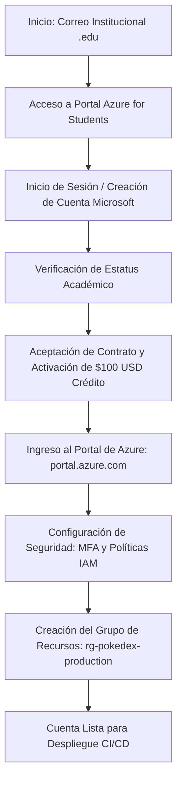

# 🔴 Pokédex Angular — Pueblo Paleta Inc.

---

## 📋 Información del Proyecto y Caso de Estudio

| Parámetro | Detalle |
| :--- | :--- |
| **Organización** | Pueblo Paleta Inc. |
| **Proyecto** | Despliegue y Aseguramiento de Aplicación Pokédex en Nube Pública |
| **Estudiante / Desarrollador** | Milton Berrío |
| **Repositorio Oficial** | [https://github.com/MiltonBerrio/pokedex](https://github.com/MiltonBerrio/pokedex) |
| **URL Pública en Producción** | **[https://gentle-pebble-03dd9761e.4.azurestaticapps.net](https://gentle-pebble-03dd9761e.4.azurestaticapps.net)** |
| **Nube Pública Seleccionada** | **Microsoft Azure** (Azure for Students / Azure Static Web Apps) |
| **Asignatura** | Sistemas Distribuidos |

---

## 📖 Introducción y Contexto

La compañía **Pueblo Paleta Inc.** ha contratado a nuestro equipo para realizar la migración y despliegue del código fuente de su aplicación web **Pokédex** (desarrollada en el framework **Angular 14** con consumo de la API RESTful y GraphQL de **PokéAPI**) hacia una infraestructura de **nube pública de nivel empresarial**.

Debido a que la compañía ha enfrentado reiterados ciberataques en sus plataformas digitales, la infraestructura elegida debe garantizar:
1. **Alta disponibilidad y escalabilidad global** mediante una Red de Entrega de Contenidos (CDN).
2. **Aprovisionamiento automatizado e integración continua (CI/CD)** conectada con el repositorio de GitHub.
3. **Máximo estándar de seguridad perimetral**, cumpliendo rigurosamente con una calificación **A+** en auditorías de [SecurityHeaders.com](https://securityheaders.com/) y políticas de cifrado TLS/SSL certificadas.

Para dar cumplimiento a estos requerimientos, se seleccionó **Microsoft Azure** como el proveedor de nube pública, aprovechando el programa académico **Azure for Students**, el cual proporciona un entorno cloud robusto, seguro y sin costos para el desarrollo de la solución.

---

## ☁️ Tutorial Paso a Paso: Creación y Configuración de Cuenta en Microsoft Azure

A continuación, se detalla el proceso completo de registro, verificación de identidad académica y configuración inicial de seguridad de la cuenta en la nube pública de **Microsoft Azure**.

---

### Paso 1: Verificación de Requisitos Previos

Antes de iniciar el registro, asegúrese de contar con los siguientes elementos:

1. **Correo electrónico institucional universitario**: Debe poseer un dominio educativo válido (por ejemplo: `@universidad.edu`, `@institucion.edu.co`).
2. **Navegador web moderno**: Chrome, Edge, Firefox o Brave en modo estándar (sin bloqueadores de scripts agresivos durante el proceso de verificación).
3. **Teléfono móvil**: Para validación en dos pasos (SMS o aplicación autenticadora).
4. *Nota importante*: **Azure for Students NO requiere tarjeta de crédito ni débito**, evitando cargos inesperados y garantizando acceso inmediato a $100 USD en créditos y servicios gratuitos de por vida.

---

### Paso 2: Acceso a la Plataforma de Azure for Students

1. Abra su navegador web e ingrese al portal oficial de registro para estudiantes de Microsoft Azure:
   👉 **[https://azure.microsoft.com/es-es/free/students/](https://azure.microsoft.com/es-es/free/students/)**
2. En la pantalla principal, observe los beneficios otorgados:
   - **$100 USD de crédito de Azure** válidos por 12 meses (renovables anualmente mientras se mantenga la condición de estudiante).
   - Acceso a más de **55 servicios en la nube siempre gratuitos**, incluidos **Azure Static Web Apps**, Azure App Services, Azure Functions, Cosmos DB y almacenamiento Blob.
3. Haga clic en el botón verde destacado: **"Empiece gratis"** (o *"Start free"*).

---

### Paso 3: Autenticación con Credenciales Universitarias

1. El sistema lo redireccionará a la pantalla única de inicio de sesión de Microsoft (`login.microsoftonline.com`).
2. Ingrese su **dirección de correo electrónico institucional**.
3. Haga clic en **"Siguiente"**:
   - Si su universidad cuenta con convenio federado de identidad (Office 365 / Microsoft Entra ID), será redirigido al portal de autenticación institucional de su universidad. Ingrese su contraseña universitaria habitual.
   - Si su correo no está registrado previamente como cuenta Microsoft, el asistente le solicitará crear una contraseña segura para la cuenta Microsoft asociada a dicho correo institucional.

---

### Paso 4: Comprobación de la Identidad Académica

Para certificar que el solicitante es un estudiante activo, Azure ejecuta una validación de identidad:

1. **Selección del método de comprobación**:
   - Seleccione la opción recomendada: **"Dirección de correo electrónico de la institución educativa"**.
2. **Envío de código de validación**:
   - Azure enviará un mensaje con un código de verificación numérico de un solo uso (OTP) a su bandeja de entrada universitaria.
3. **Confirmación del código**:
   - Abra el correo recibido de `Microsoft Azure`, copie el código de verificación e ingréselo en el campo de texto de la página de registro.
   - Haga clic en **"Comprobar estado de estudiante"**.

---

### Paso 5: Registro del Perfil y Activación de la Suscripción

Una vez aprobada la validación estudiantil:

1. **Formulario de Información de Contacto**:
   - Diligencie su país o región, nombre completo, apellidos y número de teléfono de contacto.
2. **Términos y Condiciones**:
   - Lea y marque la casilla de aceptación del **Acuerdo de suscripción de Microsoft Azure**, las **Condiciones de la oferta de Azure for Students** y la **Declaración de privacidad**.
3. **Finalización del Registro**:
   - Haga clic en el botón **"Suscribirse"** o **"Registrarse"**.
   - El sistema aprovisionará la suscripción en los centros de datos globales de Microsoft. Este proceso toma entre 30 y 60 segundos.
   - Al finalizar, aparecerá la confirmación: *"¡Te damos la bienvenida a Azure!"*.

---

### Paso 6: Primer Acceso al Portal de Administración de Azure

1. Diríjase a la consola oficial de administración en la nube:
   👉 **[https://portal.azure.com/](https://portal.azure.com/)**
2. Inicie sesión con su cuenta educativa verificada.
3. En el buscador superior, escriba **"Suscripciones"** y seleccione el servicio:
   - Verifique que figure una suscripción con el nombre: **"Azure for Students"**.
   - Compruebe que el estado sea **"Activo"** y que el saldo disponible refleje los **$100.00 USD**.

---

### Paso 7: Buenas Prácticas y Configuraciones Iniciales de Seguridad

En concordancia con las directivas de seguridad corporativa exigidas por **Pueblo Paleta Inc.** para mitigar ciberataques, se implementaron las siguientes configuraciones dentro del tenant de Azure:

#### 1. Activación de Autenticación Multifactor (MFA)
* Diríjase a **Microsoft Entra ID** (anteriormente Azure Active Directory) > **Usuarios** > su usuario > **Métodos de autenticación**.
* Registre la aplicación **Microsoft Authenticator** o verificación por SMS para blindar el acceso al portal contra ataques de fuerza bruta o suplantación de identidad.

#### 2. Creación del Grupo de Recursos Dedicado (`Resource Group`)
Un grupo de recursos es un contenedor lógico que almacena y gestiona los recursos de una solución de manera centralizada:
1. En la barra de búsqueda superior de Azure, escriba **"Grupos de recursos"** (Resource groups) y haga clic en **"+ Crear"**.
2. Configure los siguientes parámetros:
   - **Suscripción**: `Azure for Students`.
   - **Grupo de recursos**: `rg-pokedex-production`.
   - **Región**: `(US) East US 2` (o la región más cercana recomendada con baja latencia).
3. Haga clic en **"Revisar y crear"** y luego en **"Crear"**.

#### 3. Configuración de Alerta de Presupuesto (Cost Management & Budgets)
Para prevenir el agotamiento imprevisto del crédito:
1. En el menú de navegación, busque **"Cost Management + Facturación"** > **"Presupuestos"**.
2. Cree un presupuesto mensual con un umbral del **80%**, configurando el envío de alertas automáticas al correo electrónico institucional en caso de alcanzar dicho consumo.

---

## 🚀 Próximo Paso: Despliegue de la Aplicación

Con la cuenta en la nube pública de **Microsoft Azure** creada, asegurada y verificada exitosamente, el entorno se encuentra completamente preparado para publicar la aplicación **Pokédex**.

👉 Para consultar la guía detallada de despliegue continuo mediante **Azure Static Web Apps**, GitHub Actions y la configuración de los **encabezados de seguridad para calificación A+**, consulte el archivo:

### 📄 **[Ver Guía Completa de Despliegue (Despliegue.md)](Despliegue.md)**

---

## 🛠️ Herramientas Utilizadas

- **Nube Pública**: Microsoft Azure (Azure for Students).
- **Editor Markdown**: [StackEdit](https://stackedit.io/) — Editor y visualizador Markdown en la nube con soporte GFM y KaTeX.
- **Control de Versiones**: Git & GitHub ([MiltonBerrio/pokedex](https://github.com/MiltonBerrio/pokedex)).
- **Framework Frontend**: Angular 14.
